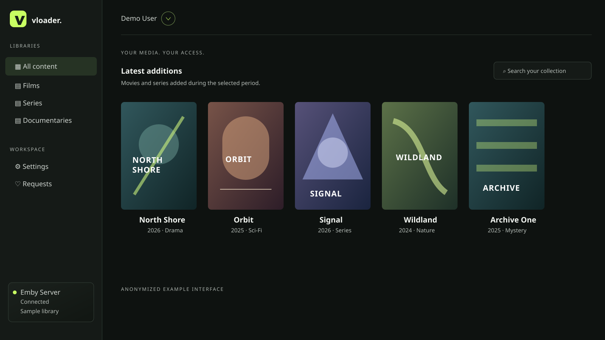
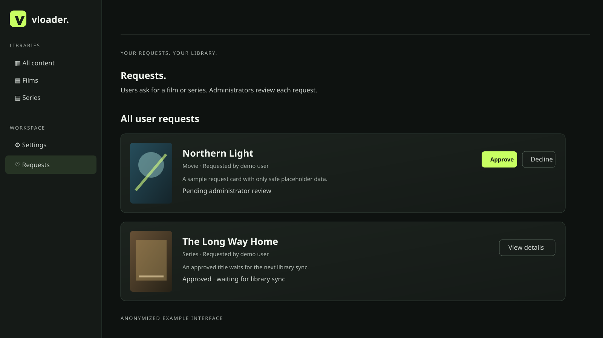

# vloader

<p align="center">
  
</p>
<p align="center">A web interface for browsing, requesting, and downloading media from an Emby library.</p>

<p align="center">
  
</p>

## Overview

vloader mirrors the configured Emby libraries into an authenticated web interface. It is designed for a small, self-hosted media environment where the original files remain on Emby or on a read-only NFS/SMB source.

vloader lets you:

- browse movies and series by Emby library
- use **All content** as a dashboard for recent movie and series additions
- view titles, artwork, metadata, video details, and audio tracks
- download original movies and individual episodes; downloading a season starts one download per episode
- use a responsive interface on phones, tablets, and desktop browsers
- request movies and series through Radarr and Sonarr search
- approve requests with an administrator-selected destination folder
- review all requests, monitor active download progress, and remove individual completed or cancelled download-history entries in a dedicated administrator workspace
- notify administrators about new requests and requesters when a title becomes available in Emby
- trigger a library sync from a Radarr or Sonarr webhook
- authenticate with a local administrator account, OIDC, or both

All library data, settings, request state, and credentials are kept in the persistent `/data` volume. The media source is always separate and read-only.

<p align="center">
  
</p>

## Quick Start

1. Create the Compose and environment files:

```bash
cp compose-template.yml compose.yml
cp .env.example .env
```

2. Set a strong local administrator password and the exact browser origin in `.env`:

```dotenv
ADMIN_PASSWORD=replace-with-a-random-password-of-at-least-16-characters
APP_URL=http://localhost:8090
```

Generate a password with `openssl rand -hex 24` if needed.

3. Create the persistent data directory and grant the container account access:

```bash
mkdir -p ./data
sudo chown 10001:10001 ./data
sudo chmod 700 ./data
```

4. Start vloader:

```bash
docker compose up -d --build
```

5. Open:

```text
http://localhost:8090
```

Sign in as `admin` with the password from `.env`. The default Compose template publishes only on loopback. For remote access, use HTTPS through a trusted reverse proxy and set `APP_URL` to that exact public origin.

### Production image

For a published image, use the production template:

```bash
cp compose-production-template.yml compose.yml
cp .env.example .env
```

Set `VLOADER_VERSION` in `.env` to an image tag such as `0.3` for the current minor series or `0.3.1` to pin an exact release. Then create `./data` with UID/GID `10001` and run:

```bash
docker compose up -d
```

For direct NFS or SMB downloads, copy exactly one documented mount block from [compose-template.yml](compose-template.yml) into the production service before starting it.

## Web Interface

### Libraries and downloads

After signing in, choose a library from the left navigation. Movie libraries show movies only; TV libraries show series, seasons, and episodes in their counters. **All content** shows recently created movies and series, newest first. Its time window is configurable from 1 to 365 days in **Settings → All content**.

Opening a title shows its Emby metadata. Movies and individual episodes download through the browser. A season download starts an individual browser download for every episode.

On phones and tablets, use the menu button in the top bar to open all libraries, Settings, Requests, Sync, and Sign out. Poster images load lazily to reduce mobile bandwidth and parsing work.

### Connect Emby and Jellyfin

Open **Settings → Connection** and choose **Emby** or **Jellyfin** from the server selector. Each server has its own:

- server URL, optionally including a base path
- API key created in the server's administration settings
- the transfer method and source path

Both servers can be enabled at once. vloader keeps their item identifiers separate, merges their libraries into one collection, and routes images and downloads back to the correct source. Administrators can start a manual sync from the **Sync** button. Scheduled sync is configured on the same settings page.

In **Settings → All content**, administrators can hide selected imported libraries from normal users. Hidden libraries remain visible to administrators, including their images and downloads. vloader preserves library and item IDs, parent relationships, descriptions, release information, genres, ratings, media sources, streams, and image references. Artwork is fetched from the configured media server only when the browser requests it. If a sync fails, the last successful catalog remains available.

### Requests, Radarr, and Sonarr

Configure the Radarr and Sonarr URLs and API keys under **Settings → Automation**. Users then search the matching service from **Requests** and select the exact movie or series. This creates a pending request only.

An administrator sees every request in the dedicated **Admin** workspace, selects a destination folder and quality profile returned by Radarr or Sonarr, and approves or declines it. The same workspace lists active browser downloads with the user, title, bytes transferred, and remaining size. Where Sonarr provides language profiles, the administrator selects one of those too. On approval, vloader sends the selected title and choices to the matching service. Root folders and profiles remain managed by Radarr and Sonarr; their API keys never reach the browser.

Request cards show the selected poster and details returned by Radarr or Sonarr. During each Emby sync, vloader checks approved requests against the mirrored library. When it finds a match, the request becomes available and exposes its download action.

### Notifications

Open **Settings → Notifications** to configure delivery channels and choose the events for each channel independently:

- New requests
- Started downloads, including the user, title, media type and local server timestamp
- Approved requests that become available in Emby after a sync

For email, enter the administrator address and SMTP settings, save, then use **Send test email**. SMTP uses STARTTLS with certificate validation by default; disabling TLS is intended only for a trusted plain-SMTP relay. Requester availability emails require a verified OIDC `email` claim and are never returned by the API.

For Slack, create an **Incoming Webhook** in the Slack app configuration, select the destination channel, and copy its generated webhook URL. Paste that URL into **Slack → Incoming Webhook URL**, save the settings, then use **Send test Slack message**. vloader accepts only Slack webhook URLs in this form:

```text
https://hooks.slack.com/services/...
```

The webhook is stored as a secret, is never returned to the browser after saving, and can be removed from the Notifications page.

### External sync API

Radarr or Sonarr can trigger a vloader sync after an import. An administrator creates the webhook key under **Settings → Automation → External library sync**. The raw key is shown once; vloader stores only its SHA-256 hash.

Send a `POST` request to `/api/external/sync` with either `X-Api-Key` or an Authorization Bearer token:

```bash
curl -X POST \
  -H 'X-Api-Key: YOUR_KEY' \
  https://vloader.example.com/api/external/sync
```

vloader responds immediately with `202 Accepted` and queues the catalog sync in the background, so Radarr and Sonarr webhooks do not time out while large libraries are processed. Generating a replacement key invalidates the previous key. **Revoke API key** disables external sync immediately.

## Authentication

vloader supports:

- local administrator sign-in
- OpenID Connect sign-in
- both methods at the same time

The local account is `admin`. Set `LOCAL_AUTH_ENABLED=false` only after configuring OIDC completely.

For OIDC, register this callback URL at the identity provider:

```text
${APP_URL}/auth/callback
```

vloader uses Authorization Code Flow with PKCE S256. It authorizes users by exact stable `sub` values and/or exact group values from the verified ID token. The displayed name uses `display_name`, then `name`; access control always uses the stable subject and verified groups.

```dotenv
OIDC_ISSUER=https://id.example.com/realms/media
OIDC_CLIENT_ID=vloader
OIDC_CLIENT_SECRET=
OIDC_ALLOWED_SUBJECTS=
OIDC_GROUPS_CLAIM=groups
OIDC_ALLOWED_GROUPS=vloader-users
OIDC_ADMIN_GROUPS=vloader-admins
OIDC_ADMIN_SUBJECTS=
```

For Pocket ID, assign the configured group claim to the vloader OIDC client so that `groups` is present in the ID token. Settings can also be maintained from **Settings → Authentication**; client secrets are never returned to the browser.

## Media Source Options

The default and simplest option is **Emby API** downloads. Configure it entirely in **Settings → Connection**.

For direct original-file downloads, vloader can mount one NFS or SMB share read-only at `/media`. The container starts as root only to establish the mount, then switches to UID/GID `10001:10001`. The application never mounts filesystems from an HTTP request.

All network-mount variants are documented in [compose-template.yml](compose-template.yml). Copy exactly one NFS or SMB block into `compose.yml`, set the corresponding `.env` variables, and restart the container.

### NFS

Set `SOURCE_MOUNT: nfs`, `NFS_SERVER`, and `NFS_EXPORT`. vloader uses NFSv4 over TCP. If Emby reports `/mnt/movies/Film/movie.mkv` and the exported share contains `Film/movie.mkv`, use `/mnt/movies` as the source prefix in Settings; the file then resolves below `/media` inside vloader.

### SMB

Set `SOURCE_MOUNT: smb`, `SMB_SERVER`, `SMB_SHARE`, `SMB_CREDENTIAL_USERNAME`, and `SMB_CREDENTIAL_PASSWORD`. Use `DOMAIN\\username` for domain accounts or only the username for local NAS accounts. The startup script writes credentials to a mode-0600 temporary file only while mounting and removes it afterwards.

The Docker host needs NFS or CIFS kernel support. Do not mount the media source below `/data`: `/data` is reserved for vloader state.

## Runtime Folders

| Path | Purpose |
| --- | --- |
| `./data` | Persistent `settings.json`, `catalog.json`, and `wishes.json` data; mounted at `/data` |
| `/media` | Read-only NFS/SMB source mount inside the container when enabled |
| `./vloader` | Go source, embedded web interface, Docker build context, scripts, and documentation |

## Compose and Environment Variables

| Variable | Default | Description |
| --- | --- | --- |
| `APP_URL` | `http://localhost:8090` | Exact browser origin; required for mutation-origin checks and the OIDC callback URL |
| `BIND_ADDRESS` | `127.0.0.1` | Host address used for the published HTTP port |
| `PORT` | `8090` | Host port mapped to vloader |
| `TZ` | `Europe/Zurich` | IANA timezone used for displayed timestamps and notifications |
| `ADMIN_PASSWORD` | required | Local administrator password; at least 16 characters when local auth is enabled |
| `LOCAL_AUTH_ENABLED` | `true` | Enables local administrator sign-in |
| `VLOADER_DATA_DIR` | `./data` | Host path mounted at `/data` |
| `VLOADER_VERSION` | `0.2` in the production template | Published GHCR image tag; use an exact patch version to pin a release |
| `APP_VERSION` | `dev` | Version shown in the web interface; set this to the installed release tag |
| `OIDC_ISSUER` | empty | OIDC issuer URL |
| `OIDC_CLIENT_ID` | empty | OIDC client ID |
| `OIDC_CLIENT_SECRET` | empty | OIDC client secret, if required by the provider |
| `OIDC_ALLOWED_SUBJECTS` | empty | Comma-separated stable `sub` values allowed to sign in |
| `OIDC_GROUPS_CLAIM` | `groups` | Verified ID-token claim containing group values |
| `OIDC_ALLOWED_GROUPS` | empty | Comma-separated groups allowed as regular users |
| `OIDC_ADMIN_GROUPS` | empty | Comma-separated groups granted administrator access |
| `OIDC_ADMIN_SUBJECTS` | empty | Comma-separated `sub` values granted administrator access |
| `NFS_SERVER`, `NFS_EXPORT` | empty | NFS source configuration when `SOURCE_MOUNT=nfs` is enabled in Compose |
| `SMB_SERVER`, `SMB_SHARE` | empty | SMB source configuration when `SOURCE_MOUNT=smb` is enabled in Compose |
| `SMB_CREDENTIAL_USERNAME`, `SMB_CREDENTIAL_PASSWORD` | empty | SMB credentials used only by the mount helper |

Emby, download-source, email, request automation, external sync, and most OIDC settings are managed in the authenticated web interface. Saved GUI settings take precedence over the initial environment values.

## Important Files

| File | Description |
| --- | --- |
| [compose.yml](compose.yml) | Active local deployment configuration |
| [compose-template.yml](compose-template.yml) | Full Compose template, including NFS and SMB examples |
| [compose-production-template.yml](compose-production-template.yml) | Production template using the published GHCR image |
| [.env.example](.env.example) | Commented environment variable reference |
| [SECURITY.md](SECURITY.md) | Security model and vulnerability reporting |
| [CHANGELOG.md](CHANGELOG.md) | User-visible changes |
| [vloader/docs/TESTING-STRATEGY.md](vloader/docs/TESTING-STRATEGY.md) | Automated and external validation scope |

## Security and Operations

The application uses HttpOnly, SameSite session cookies, origin checks for browser mutations, OIDC issuer/signature/audience/nonce/PKCE verification, and explicit subject/group allowlists. Emby redirects are not followed with credentials. Settings, catalog, and requests are written atomically with mode `0600`.

Protect the Docker host, `/data`, backups, and all configured API keys. Use HTTPS for remote access. See [SECURITY.md](SECURITY.md) for the complete security model and operational limits.

Application errors and relevant request failures are written to container logs. Inspect them with:

```bash
docker compose logs -f vloader
```

## Development and Validation

Run these commands from the repository root:

```bash
cd vloader
go test ./...
go test -race ./...
go vet ./...
go run golang.org/x/vuln/cmd/govulncheck@latest ./...
cd ..
docker compose config --quiet
docker compose up -d --build
docker compose ps
```

If Go is not installed on the host, use the pinned build image:

```bash
docker run --rm -v "$PWD/vloader:/app" -w /app golang:1.27.2-alpine \
  sh -c 'go test ./... && go vet ./...'
```

GitHub Actions runs tests, race detection, `go vet`, vulnerability checks, Compose validation, and image builds. Release tags publish the container image and create a GitHub release. Release notes must exist at `.github/release-notes/<tag>.md` before creating a tag.
